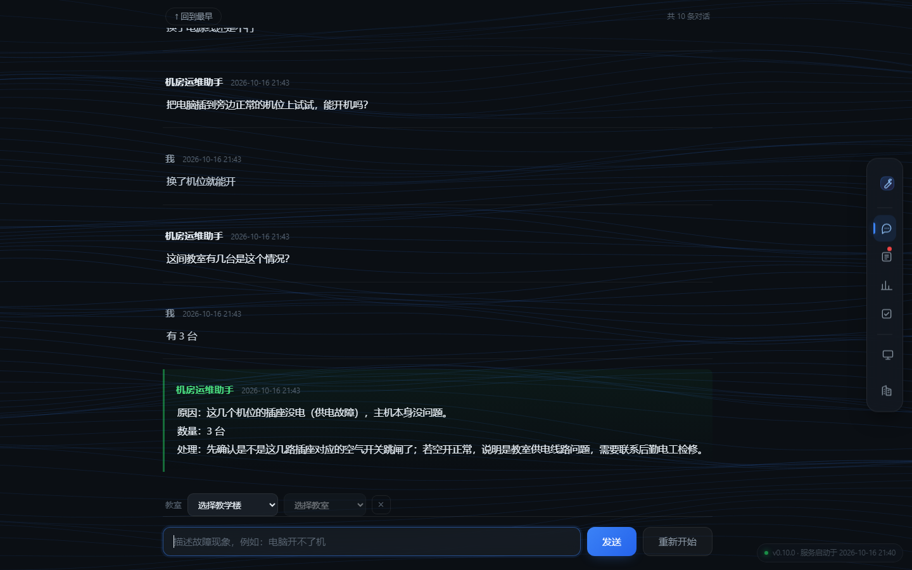
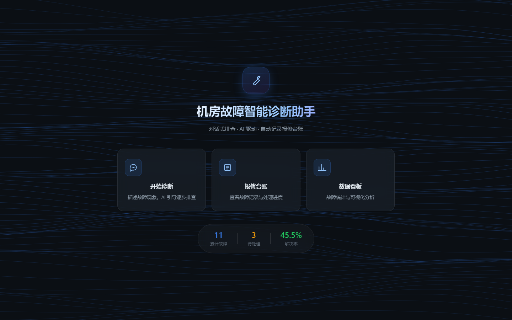
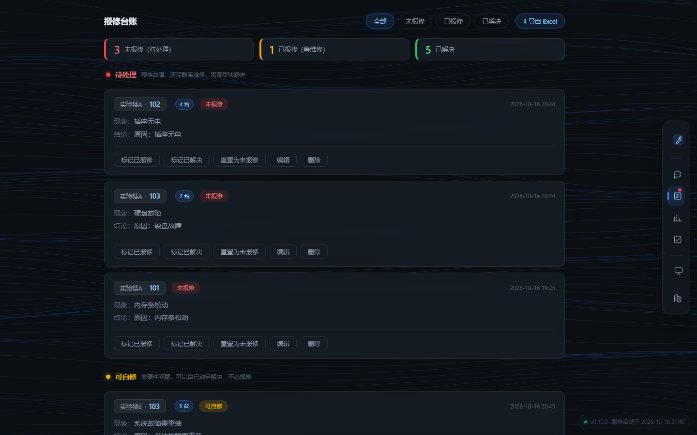
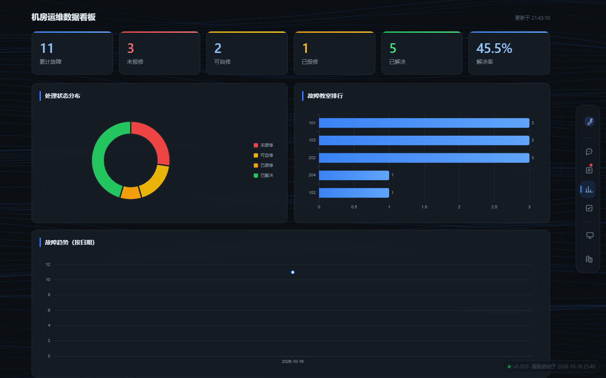
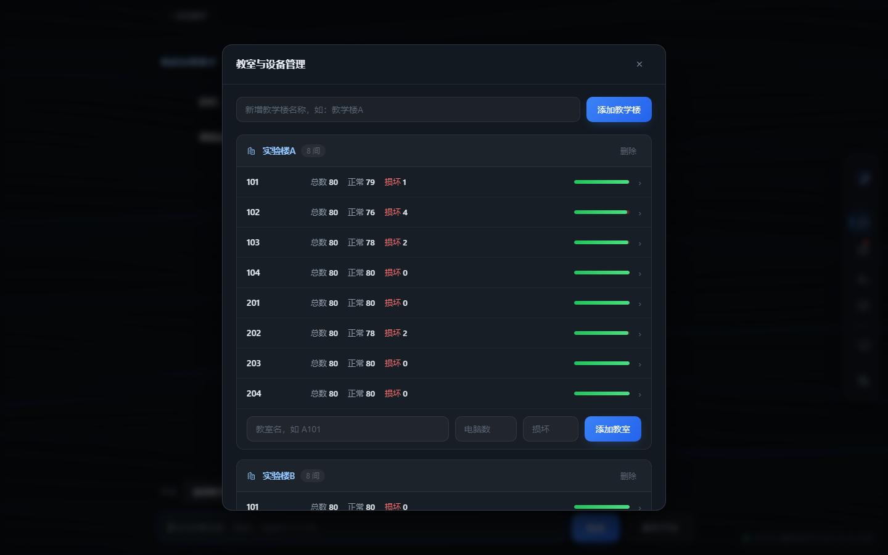
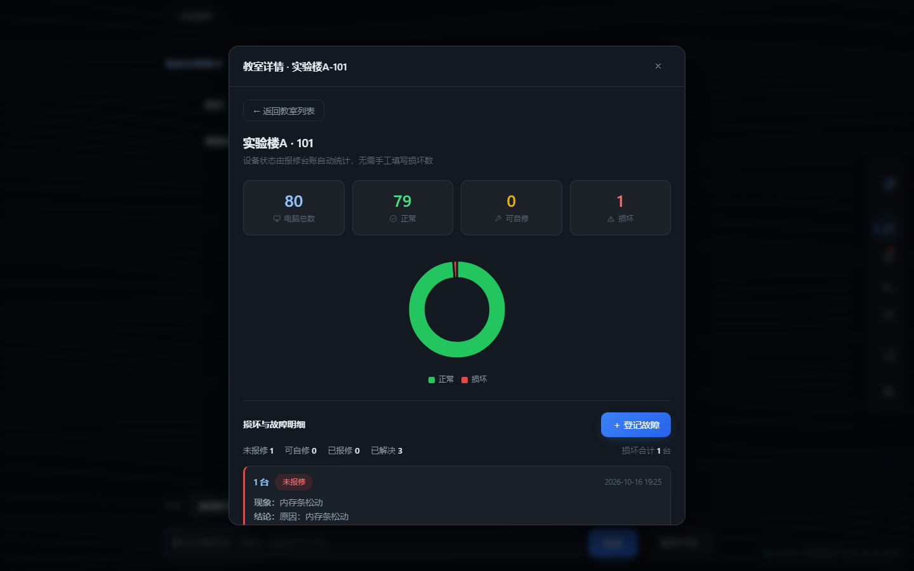
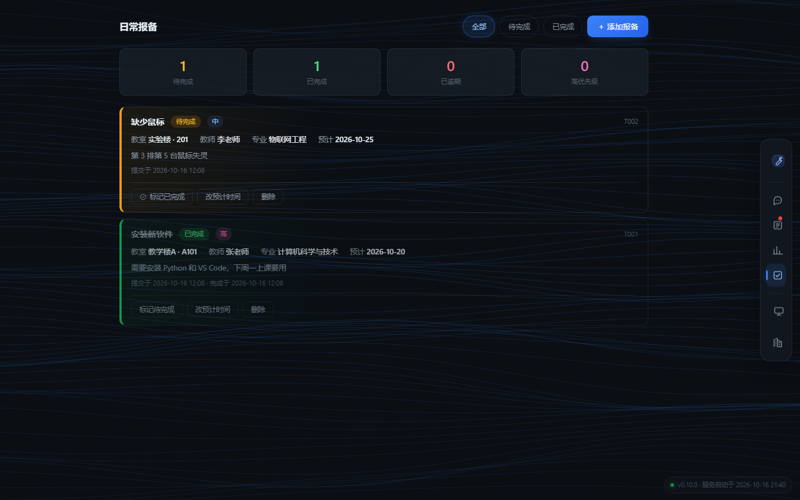

# 机房故障智能诊断助手

> 一个面向高校机房运维场景的 AI 故障排查工具。
> 用自然语言描述设备故障，AI 给出分步排查建议与处理方案。



## 项目背景

本项目的需求来自真实的机房运维工作：日常需要管理 **23 间机房教室、约 1840 台计算机设备**，
以及一支 **50 人的学生运维团队**。在实际运维中，高频故障（无法开机、网络中断、
外设失灵等）反复出现，排查过程依赖个人经验，新人上手慢、处理标准不统一。

本项目希望把这类经验沉淀成可检索、可复用的诊断工具，降低对个人经验的依赖。

> **使用情况**：本工具已投入日常机房运维使用，用于故障排查与报修台账管理。
> 下方截图均为实际运行界面。

## 界面预览

| 落地页 | 对话式诊断 |
|---|---|
|  |  |

| 报修台账 | 数据看板 |
|---|---|
|  |  |

| 教室与设备管理 | 教室详情 |
|---|---|
|  |  |

<details>
<summary>还有一张：日常报备</summary>



</details>

> 截图由 `tools/make_screenshots.py` 自动生成，改完界面后重跑即可保持一致，
> 不需要手工截图。

## 功能特性

- **对话式逐层排查**：一次只问一个问题，根据回答推进，不堆砌大段步骤
- **轻量 RAG**：本地关键词加权检索 Top-3 案例注入提示词，无需向量库
- **知识自动沉淀**：诊断结论自动写回知识库，越用越准
- **四态设备模型**：未报修 / 可自修 / 已报修 / 已解决，区分「坏没坏」与「报没报修」
- **报修台账**：教室维度记录故障，支持数量合并、状态流转、按状态分组
- **数据看板**：状态分布、教室故障排行、故障趋势
- **一页纸报表**：导出 Excel 给领导看，只回答「现在有多少台能用」
- **AI 不可用时降级**：回退到本地关键词匹配，不至于完全不能用

## 当前进度

| 版本 | 功能 | 状态 |
|---|---|---|
| v0.1.0 | 本地故障知识库 + 关键词匹配查询 | ✅ 已完成 |
| v0.2.0 | 决策树逐步诊断 | ⏸️ 暂缓（维护成本高） |
| v0.3.0 | 接入大模型 API，支持自然语言诊断 | ✅ 已完成 |
| v0.4.0 | 改为对话式逐层排查 | ✅ 已完成 |
| v0.5.0 | Web 界面、流式输出、报修台账与数据看板 | ✅ 已完成 |
| v0.6.0 | 教室设备台账、知识库检索增强与自动沉淀、日常报备 | ✅ 已完成 |
| v0.7.0 | 知识库检索增强（RAG 轻量实现）与自动沉淀 | ✅ 已完成 |
| v0.8.0 | 自动沉淀数据分离、检索粒度修复、并发写入保护 | ✅ 已完成 |
| v0.9.0 | 自动化测试与 CI、统一文件锁、会话回收 | ✅ 已完成 |
| v0.10.0 | 报修记录导出 Excel（教室现状 / 损坏明细 / 故障统计） | ✅ 已完成 |
| — | 已在日常机房运维中实际使用 | ✅ 进行中 |

> 版本号的单一来源是 `src/version.py`，改动版本时同步更新本表。

## 快速开始（10 分钟复现）

### 1. 环境要求

| 项目 | 要求 |
|---|---|
| Python | 3.10 或更高（开发环境为 3.15.0） |
| 依赖库 | `openai`、`flask`（见 `requirements.txt`） |
| API Key | DeepSeek API Key（[申请地址](https://platform.deepseek.com/)） |

检查 Python 版本：

```bash
python --version
```

### 2. 获取代码

```bash
git clone git@github.com:liyishuo1/dsh-fault-diagnosis.git
cd dsh-fault-diagnosis
```

### 3. 安装依赖

```bash
pip install -r requirements.txt
```

> 只跑命令行版（`main.py`）只需 `openai`；
> 跑 Web 版（`app.py`）必须装 `flask`。直接装 `requirements.txt` 两个都有。

### 4. 配置 API Key（重要）

程序从**环境变量**读取 API Key，**不写入代码**（避免泄露）。

**Windows（PowerShell，永久生效）：**

```powershell
[Environment]::SetEnvironmentVariable("DEEPSEEK_API_KEY", "你的key", "User")
```

设置后**需要新开一个终端**才能生效。

**临时设置（仅当前终端有效）：**

```powershell
$env:DEEPSEEK_API_KEY = "你的key"
```

**验证是否配置成功：**

```powershell
echo $env:DEEPSEEK_API_KEY
```

能输出你的 key 即表示配置成功。

### 5. 运行

**方式一：Web 版（推荐）**

```bash
cd src
python app.py
```

浏览器访问 <http://127.0.0.1:5000>，可体验诊断对话、报修台账、教室管理和数据看板。

**方式二：命令行版**

```bash
cd src
python main.py
```

### 6. 使用示例

程序启动后，直接用自然语言描述故障。AI 会**一次只问一个问题**，
根据你的回答逐步排除，最后给出结论：

```
故障描述：501教室电脑打不开

正在分析，请稍候...

→ 按开机键后，机箱指示灯亮吗？风扇转吗？

你的回答：按电源没反应，灯不亮

→ 检查一下机箱后面的电源线两头有没有插紧，插紧后再按开机键，有反应吗？

你的回答：换了电源线还是不行

→ 看一下机箱背面电源上的开关是不是被关到"O"那边了，拨到"I"再开机试试？

你的回答：开关是开的，灯也不亮

→ 把电脑插到旁边正常的机位上试试，能开机吗？

你的回答：插别的机位能开

=======================================================
【诊断结论】
=======================================================
原因：教室这个机位的插座没电，导致电脑无法供电。
处理：自己修。换到有电的机位使用，并报修该插座。

📝 已记录为待报修（编号 R001，教室 501）
   报修后请执行：done R001 已报修
```

常用命令：`help` 查看帮助、`r` 重新开始、`log` 查看报修记录、`q` 退出。

## 运行测试

项目带一套自动化测试，覆盖知识库检索、报修台账、教室管理与并发安全：

```bash
pip install -r requirements-dev.txt
python -m pytest tests -v
```

当前 **160 个测试全部通过**。测试不调用真实大模型 API，无需配置 API Key。

重点覆盖了历史上真实出现过的缺陷，防止再次退化：

| 测试类 | 防的是什么 |
|---|---|
| `TestInferCategory` | 分类误判（如"风扇声音大"被判成音频故障） |
| `TestSearch` | 检索漏配（同义表达、切分粒度）与假阳性 |
| `TestSediment` | 自动沉淀写脏手工知识库、重号、漏去重 |
| `TestConcurrency` | 多线程并发写入丢数据、锁不可重入导致死锁 |
| `TestInitFileRace` | 文件初始化的「检查-写入」竞态（`'w'` 截断写） |
| `TestStatusConstants` | 状态改名后的数据迁移、统计接口漏状态 |
| `TestExcelExport` | 报表口径（正常 + 损坏 = 总数）与纵向合并 |

CI 配置在 `.github/workflows/tests.yml`，每次推送自动在
**Windows / Linux × Python 3.10 / 3.12** 四种组合上跑一遍
（文件锁在 Windows 走 `msvcrt`、Linux 走 `fcntl`，两条分支都要验证；
历史上有一个并发缺陷**只在 Linux 暴露**，只测 Windows 是发现不了的）。

失败时 `tools/ci_report.py` 会把出错的用例名与断言行转成 GitHub annotation，
不需要仓库权限也能在网页上看到具体是哪个用例挂了。

## 报表导出（Excel）

在「报修台账」页点击 **⬇ 导出 Excel**，或直接运行：

```bash
python src/excel_export.py        # 输出到 exports/ 目录
```

导出文件名为 `机房设备运行现状_YYYY-MM-DD_HHMM.xlsx`，**只含一张工作表**：

| 列 | 内容 |
|---|---|
| 教学楼 | 纵向合并单元格，同一教学楼的教室归在一起 |
| 教室 | 教室号 |
| 设备总数 | 该教室的电脑总数 |
| 正常 | 未报修/损坏之外的可用台数 |
| 损坏 | 不能用的台数（含等维修的） |
| 损坏原因 | 简明列出现故障原因 |

### 几个口径说明

**这份报表是给谁看的**

给领导看。领导不关心「修没修、谁去修」，只关心**现在有多少台能用**。
因此报表口径是 **正常 + 损坏 = 设备总数**，账目能直接对上。
「已解决」计入正常，「未报修 / 可自修 / 已报修」一律计入损坏。

> 早期版本做了 6 张工作表（总览、故障总表、教室现状、损坏明细、故障统计、
> 未录入台账），信息量更大但**解决的不是真问题** —— 领导看不完，也看不出重点。
> 后来按「受众是谁、他要回答什么问题」重做成现在这一张。

**「损坏原因」怎么来的**

AI 的诊断结论是「原因：xxx / 处理：yyy」格式，导出时提取「原因」部分，
并截取核心故障描述，避免整段结论塞进单元格。

**教学楼缺失的记录**

若记录只填了教室号，导出时会尝试与教室台账匹配并自动补全教学楼。

## 项目结构

```
dsh-fault-diagnosis/
├── data/
│   ├── fault_cases.json          # 故障知识库（手工整理，23 条）
│   ├── fault_cases_auto.json     # 自动沉淀案例（运行时生成，不提交）
│   ├── classrooms.json           # 教室与设备台账
│   ├── daily_tasks.json          # 日常报备待办
│   ├── repair_records.csv        # 报修台账
│   ├── *.example.json            # 台账示例文件（新环境可复制使用）
│   └── decision_trees.json       # 决策树数据（暂缓使用）
├── docs/
│   ├── 技术文档.pdf                # 技术文档（含架构、核心实现、缺陷复盘）
│   ├── 技术文档.html               # 上面那份 PDF 的源文件
│   ├── 开发过程记录.md             # 开发过程与 Prompt 链
│   ├── AI对话记录-完整版.md         # 与 AI 协作的完整原始对话
│   ├── AI对话记录-关键片段.md       # 精选：提问 → 方案 → 踩坑 → 修复
│   └── screenshots/                # README 截图（由脚本生成）
├── src/
│   ├── main.py                   # 命令行主程序
│   ├── app.py                    # Web 版后端（Flask，23 个接口）
│   ├── ai_diagnosis.py           # AI 诊断模块（对话式 + 检索增强）
│   ├── knowledge.py              # 知识库检索与自动沉淀
│   ├── classroom.py              # 教室与设备台账
│   ├── daily_task.py             # 日常报备待办
│   ├── repair_log.py             # 报修记录
│   ├── excel_export.py           # 报修记录导出 Excel
│   ├── filelock.py               # 跨平台文件锁（可重入，并发写入保护）
│   ├── version.py                # 版本号（单一来源）
│   └── decision_tree.py          # 决策树引擎（暂缓使用）
├── web/
│   ├── templates/index.html      # 页面
│   └── static/                   # 样式、脚本、ECharts（本地引入）
│       └── screenshot-probe.html # 截图探针（仅供生成 README 截图）
├── tools/
│   ├── make_screenshots.py       # 自动生成 README 截图
│   ├── ci_report.py              # CI 失败用例转 annotation
│   └── export_conversation.py    # 导出 AI 对话记录
├── tests/                        # 自动化测试（pytest，160 个）
├── .github/workflows/tests.yml   # CI：推送自动跑测试
├── requirements.txt
├── requirements-dev.txt
├── .gitignore
└── README.md
```

## 故障知识库格式

知识库为 JSON 格式，AI 回答时会参考这些案例。

| 字段 | 说明 |
|---|---|
| `id` | 案例编号，如 `PC-001` |
| `category` | 故障分类，如"开机故障" |
| `symptom` | 现象描述 |
| `causes` | 可能原因列表 |
| `steps` | 排查步骤列表 |
| `severity` | 严重程度 |
| `est_time` | 预计处理耗时 |

示例：

```json
{
  "id": "PC-001",
  "category": "开机故障",
  "symptom": "按开机键没有任何反应，指示灯不亮，风扇不转",
  "causes": ["电源线未插紧或插座无电", "电源开关被关闭"],
  "steps": [
    "检查电源线两端是否插紧",
    "换一个插座测试"
  ],
  "severity": "高",
  "est_time": "5-10 分钟"
}
```

## 技术实现说明

### AI 提示词设计

系统提示词的核心是**强制 AI 一次只做一件事**，避免一次性甩出上千字的清单：

```
你是一名高校机房的运维工程师，正在通过对话帮学生管理员排查设备故障。

核心规则：
1. 每次回复只做一件事：要么问一个问题，要么给出结论
2. 第一句必须先问教室号（用户已说明则跳过）
3. 第二步问清具体表现，不要直接跳到排查
4. 用户说"不行"就排除该原因，进入下一个新的可能
5. 绝不重复问同一个问题，也不换个说法再问一遍
6. 能确定原因时，第一行输出【诊断结束】，然后给结论
```

配合 `max_tokens=300` 限制回复长度，强制精简。

### 知识库检索增强（RAG 的轻量实现）

**早期做法**：把 `fault_cases.json` 全部案例塞进 system 消息 —— 案例一多就浪费 token，还会干扰判断。

**现在做法**：`knowledge.py` 先用**本地关键词加权检索**找出最相关的 Top-3 案例，只注入这几条：

| 权重 | 命中位置 |
|---|---|
| ×3.0 | 故障分类一致 |
| ×2.0 | 现象描述命中 |
| ×1.0 | 可能原因命中 |
| 额外加成 | 命中关键特征词表（如"蓝屏""断网"给 3.0） |

纯本地计算，不依赖向量库或额外服务，零成本。

### 知识库自动沉淀

诊断结束后，若结论为「自己修」（已报修的不沉淀，因为结论尚未验证），
系统会把现象与结论提取成结构化案例写回知识库，实现**越用越聪明**：

- 自动推断故障分类（按「越具体越靠前」的规则表匹配）
- 按分类分配编号（如 `PC-002`、`NET-003`），并与手工案例避让、不会重号
- 现象高度相似的案例自动去重，不重复添加

**知识库分两个文件**，各管各的：

| 文件 | 内容 | 谁维护 | 是否提交 |
|---|---|---|---|
| `data/fault_cases.json` | 手工整理的案例 | 人工编辑 | ✅ 提交 |
| `data/fault_cases_auto.json` | 程序自动沉淀的案例 | 程序追加 | 🚫 忽略 |

这样拆开的原因：自动沉淀属运行时数据，如果和手工知识混在一个文件里，
每跑一次诊断都会产生 diff，两者无法分别评审。
拆分后，**人工积累的经验可以随仓库传递、评审和回滚**，
而机器生成的数据不会污染提交记录。程序读取时会把两个文件合并使用。

### 安全设计

- API Key 只从环境变量读取，代码中无明文
- `.gitignore` 排除 `.env` 等敏感文件及运行时台账数据
- 参数 `temperature=0.3`，让回答更稳定专业

## 开发过程

完整的开发过程、与 AI 的协作记录、遇到的问题及解决方式，
见 [docs/开发过程记录.md](docs/开发过程记录.md)。

## 作者

李一硕（liyishuo1）

## 许可证

待定
