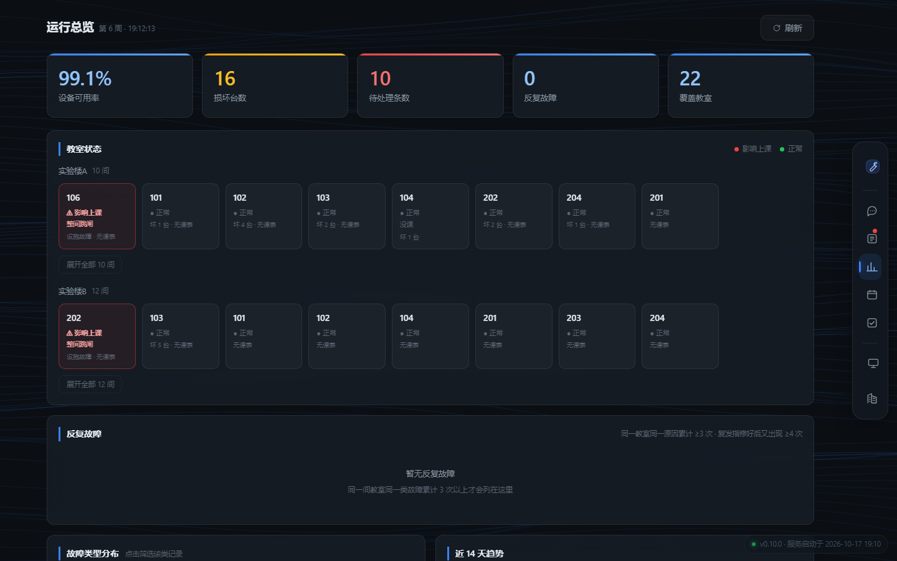
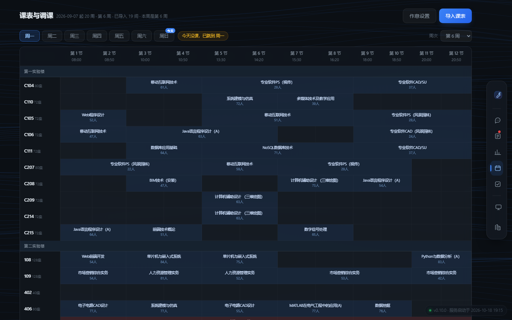
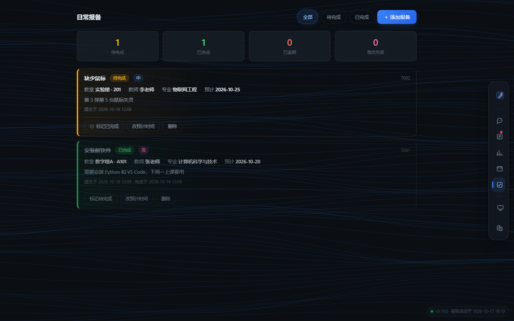
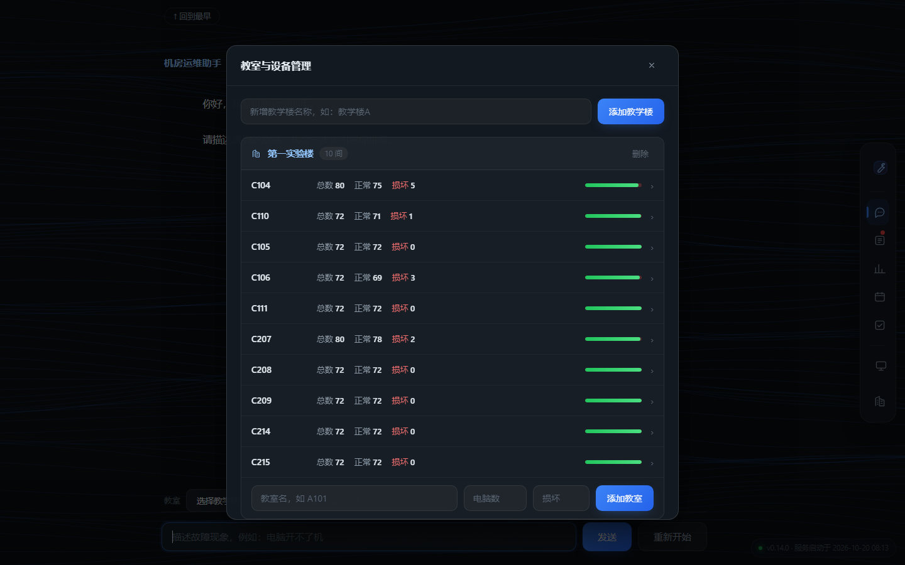
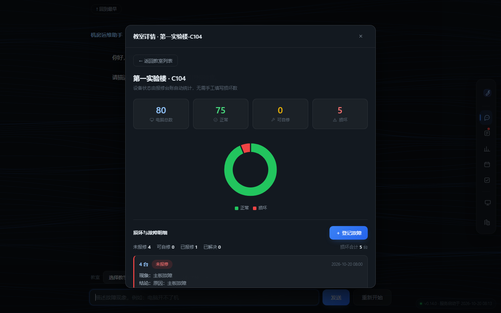

# 机房故障智能诊断助手

面向高校机房运维的 AI 故障排查工具：用自然语言描述现象，AI 逐层问诊给出故障原因，
自动落成报修台账，并结合课表判断哪几节课受影响、可以挪到哪间教室。

## 界面

| 落地页 | 对话式诊断 |
|---|---|
|  |  |

| 报修台账 | 运行总览 |
|---|---|
|  |  |

| 课表与调课 | 日常报备 |
|---|---|
|  |  |

| 教室与设备管理 | 教室详情 |
|---|---|
|  |  |

## 安装与运行

### 环境要求

| 项目 | 要求 |
|---|---|
| Python | 3.10 或更高（开发环境为 3.15.0） |
| 依赖库 | 见 `requirements.txt` |
| API Key | DeepSeek API Key（[申请地址](https://platform.deepseek.com/)） |

```bash
python --version
```

### 1. 获取代码

```bash
git clone git@github.com:liyishuo1/dsh-fault-diagnosis.git
cd dsh-fault-diagnosis
```

### 2. 安装依赖

```bash
pip install -r requirements.txt
```

### 3. 配置 API Key

程序从环境变量读取 Key，**不写入代码**。
需要配哪几项、每项什么含义，见根目录的 **`.env.example`**（环境变量模板）。

**Windows（PowerShell，永久生效）：**

```powershell
[Environment]::SetEnvironmentVariable("DEEPSEEK_API_KEY", "你的key", "User")
```

设置后需要**新开一个终端**才生效。

**临时设置（仅当前终端有效）：**

```powershell
$env:DEEPSEEK_API_KEY = "你的key"
```

**验证：** `echo $env:DEEPSEEK_API_KEY` 能输出你的 key 即可。

### 4. 运行

**方式一：一键启动（推荐）**

- **Windows**：双击根目录的 `start.bat`
- **Linux / macOS**：`./start.sh`

脚本会自动检查依赖、读取 API Key、检查端口占用，并打开浏览器。

```powershell
.\start.bat -Port 5001      # 换端口
.\start.bat -NoBrowser      # 不自动开浏览器
```

**方式二：桌面窗口版（Windows）**

双击根目录的 `desktop.bat`，直接弹出一个最大化窗口，没有地址栏、没有标签页、没有控制台。
关闭窗口即退出程序。

```bash
pip install pywebview
```

侧边栏底部的**设置**按钮可以查看 / 修改 / 清除 API Key，以及打开数据目录。

**方式三：打包成 exe（不用装 Python）**

```bash
tools\build_exe.bat
```

产物在 `dist\机房故障智能诊断助手\`，**整个文件夹一起拷走**，双击里面的 exe 即可。

源数据（教室台账、报修记录、课表）放在程序同目录的 `data\` 下。
