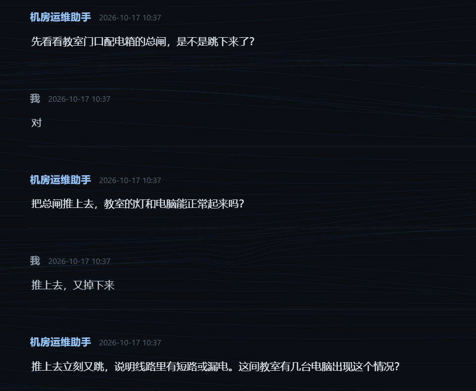

# 使用与迭代日志

> 记录日常运维使用中发现的问题、灵感，以及对应的改动。

这份日志的作用是把「真实使用」和「代码演进」连起来：
往下翻能看到项目不是一次性做完的，而是**每天在用的过程中发现问题、再改**。
参赛材料里的「解题有效性」和「开发过程可复现」都可以引它作为佐证。

## 项目时间线

- **2026-10-15 ~ 10-16**：从零完成核心功能与工程化建设
  （v0.1.0 → v0.10.0，共 8 个迭代：知识库 → 接入大模型 → 对话式排查 →
  Web 界面 → 设备台账与报修闭环 → 检索增强与自动沉淀 → 数据分离与并发保护 →
  自动化测试与 CI → 报表与界面重构）
- **2026-10-17 起**：进入**持续使用与迭代**阶段，根据实际运维中发现的问题逐步完善

## 怎么记

**新发现的问题写进下面的「待处理」区**，我按那里的内容动手；
处理完会把它挪到当天的日期条目里，并填上对应的 commit。

每条尽量带上三样东西：**什么时候 · 发现了什么 · 改了什么**

写的时候说清「看到什么现象」+「期望怎样」就够了，
不用自己分析原因 —— 定位问题我来做。

---

## 待处理（新问题写这里）

<!--
  格式随意，建议：
  - [ ] 日期：看到的现象 + 觉得应该怎样
  处理完我会打钩并挪走。
-->

- [ ] （暂无）

---

## 待办（想加的功能，不着急）

- [ ] 导入课表功能，实时显示上课教室。用于教室发生突发状况，调课到附近教室。

---

## 2026-10-17

**使用情况**

- 用真实故障跑了几轮诊断：总闸跳闸、教室没电、教室断网

**发现的问题**

1. **教室级设施故障被算成"电脑损坏"**
   总闸跳闸、交换机故障这类教室设备问题，只能按「电脑损坏」记录，
   于是显示成"损坏 80 台电脑"—— 电脑其实一台都没坏，坏的是配电箱。
   应该单独列一类。
2. **报表缺少损坏时间**
   只有"损坏几台"，看不出这个问题是什么时候出现的。
3. **⚠ 安全提示错误：让学生反复推闸**
   助手指引"把总闸推上去……"，
   而短路状态下反复合闸可能产生电弧甚至火灾。
   掉闸推一次不行就应该禁止学生再动。

   

   截图里 AI 连续两轮让学生推闸，最后还追问"有几台电脑出现这个情况" ——
   整间教室都断电了，问"几台"没有意义。
   这两处问题分别来自提示词里的两条规则（详见改动）。

**改动**

- `feat`: 新增「故障对象」字段，分「电脑 / 教室设施」两类。
  设施故障不计入损坏台数，界面与报表单独标记（`8fc933d`）
- `feat`: Excel 报表在「损坏」后加「损坏时间」列，
  并新增「教室设施故障」列（`8fc933d`）
- `fix`: 提示词安全规则 —— 总闸只允许推一次，
  推上去还跳必须停手等电工；删除「总闸跳闸合闸即可」这条自修项（`8fc933d`）
- `fix`: 提示词的数量追问改为按故障范围区分，
  整间断电不再问"几台电脑"（`8fc933d`）
- `tools`: 新增 `migrate_facility_target.py`，
  把历史记录里 3 条设施故障重新归类（已备份原文件）

---

## 统计（每次大改后更新一次）

| 项目 | 数值 |
|---|---|
| 报修记录 | 16 条 |
| 覆盖教室 | 实验楼A 10 间 / 实验楼B — 间 |
| 知识库案例（手工 / 自动沉淀） | 23 / 1 |
| 自动化测试 | 191 |
| 提交数 | 66 |